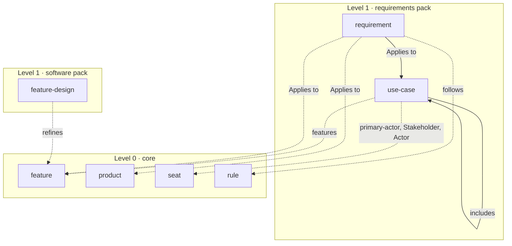

# The requirements pack

Core says what a feature gives and which products have it, and the software pack says how a feature is built. Nothing says what a feature must give someone, who wants it, what is guaranteed when it fails, or which statements a product is held to. That is requirements engineering, the problem side, and a company that writes use cases or numbered requirements today keeps them in sections no schema declares or outside the model. This spec adds a fourth pack, `requirements`, with two types, `use-case` and `requirement`, joined to core's feature so that a company taking both this pack and the software pack has the trace from what is wanted to how it is built.

Status: decided by the owner on October 11, 2026: a pack named `requirements` and not core, because both types show up in software companies only; `use-case` as Cockburn and Jacobson define it, fully dressed, at the top level; `requirement` as ISO/IEC/IEEE 29148's statement in IREB's three kinds, one file each at the top level; a use case's actors and stakeholders as core's seat where they are one; `features` on the use case as the bridge to core; subordinate use cases named once, in `includes` on the superordinate, with each step's actor resolving to a seat; a requirement's subject in an `## Applies to` table of features, products and use cases; `follows` from a requirement to the core rules it carries into the product, and no other edge; Cockburn's words for the goal levels, four of them; three design scopes; `modality` as `must`, `should` or `may`; and `## Fit criterion` as the section that makes a requirement verifiable.

## Where this comes from

Two companies show the types, both of one kind, a company that builds software.

A software company whose developers include AI agents keeps fully dressed use cases, chained from a summary goal down to a subfunction, and had nowhere in the model to put the problem-side half of them: who has an interest in the goal and what is guaranteed when it fails. It shows `requirement` only thinly, as something its use cases assume and no page of its own holds.

GuestGraph's engine, [guestgraph/engine](https://github.com/guestgraph/engine), writes one specification per slice in the shape of GitHub's spec-kit: prioritized user stories with acceptance scenarios in Given, When, Then; numbered functional requirements, `FR-001`, written with RFC 2119's keywords; and numbered success criteria, `SC-001`, which are measurable. The requirements outlive their specification. Plans, tasks, code comments, a migration and test names cite them by label, and the label is unique only within its specification, so a citation from one slice to another is ambiguous: two specifications each have an `FR-011`, and nothing written beside the label says whose. The engine shows `use-case` only thinly: a user story is a user goal with its acceptance scenarios, and no stakeholder, guarantee or extension.

Public practice gives the rest. For the use case: Cockburn and Jacobson's joint [Use-Case Foundation](https://alistaircockburn.com/Use%20Case%20Foundation.pdf), Cockburn's [basic use case template](https://www.cs.otago.ac.nz/coursework/cosc461/uctempla.htm) and his [goal levels](https://cs.otago.ac.nz/coursework/cosc461/usecases.htm), and the fully dressed form of *Writing Effective Use Cases* (Addison-Wesley, 2001); UML 2.5.1's use case, actor and include, clause 18 of the [OMG specification](https://www.omg.org/spec/UML/2.5.1/PDF); and Jacobson, Spence and Bittner's [Use-Case 2.0](https://www.ivarjacobson.com/publications/white-papers/use-case-20-e-book). For the requirement: [ISO/IEC/IEEE 29148:2018](https://www.iso.org/standard/72089.html), the [IREB CPRE glossary](https://cockpit-v1.ireb.org/media/pages/downloads/cpre-glossary/510f672cfd-1760005471/ireb_cpre_glossary_en_2.2.pdf), the [Volere snow card](https://www.volere.org/wp-content/uploads/2018/12/snowcard.pdf), [RFC 2119](https://www.rfc-editor.org/rfc/rfc2119), the [spec-kit specification template](https://github.com/github/spec-kit/blob/main/templates/spec-template.md) and SysML's requirement relationships, clause 16 of the [OMG specification](https://www.omg.org/spec/SysML/1.7/PDF).

No earlier spec deferred or rejected either type, and no issue asks for them. The software pack's spec fixed the two words this pack's edges are measured against: `realizes`, a solution fulfilling a problem-space element, and `refines`, the same thing at a finer level. It also rejected “specifies” as an edge, because in requirements practice the feature is the specification.

## Levels and the bridge

The pack is level 1, as every pack is: every edge it draws to core is optional, and no core schema names one of its types (R20). It names core's `feature`, `product`, `seat` and `rule`, and nothing from another pack. That last point decides where the trace runs. The software pack's feature design refines a core feature; this pack's use case names the feature it asks something of, and a requirement names the feature, product or use case it applies to. Neither pack names the other, so each works alone, and a company that takes both reads the trace through the feature: from a use case and its requirements, to the feature, to the designs that refine it.



A solid arrow is an edge within the pack and a dotted one an edge down to core. The software pack's feature design stands beside it to show where the two meet; no arrow runs between the packs, and none runs from core to either.

## The two types

```text
model/
  use-cases/<use-case>.md
  requirements/<requirement>.md
```

Both stand at the top. A use case may be included by more than one superordinate use case, so no one of them can own it. A requirement cannot be owned by core's feature, because a feature is a file and owning a type would make it a folder in every instance that takes the pack, and a quality requirement applies to a product or to several features at once. Every schema carries core's `id`, `source` and `source-id`, a `## References` table, and a Purpose and Writing rules pair, as every core and pack schema does.

### use-case

All the ways of using a system to achieve a particular goal for a particular user (Cockburn and Jacobson, Use-Case Foundation). `# Name` is the goal as a short active verb phrase, as Cockburn names a use case, and the `>` line says what the primary actor wants and gets.

| Field | Required | Type | Description |
| --- | --- | --- | --- |
| `level` | Yes | enum | `very high summary`, `summary`, `user goal` or `subfunction`: how high the goal stands against what a primary actor gets done in one sitting: above it twice over, above it, at it, or below it (Cockburn's goal levels, drawn as cloud, kite, waves at sea and fish) |
| `scope` | No | enum | `organization`, `system` or `component`: what the use case treats as the thing under design (Cockburn's design scope) |
| `primary-actor` | Yes | ref? → seat | Whoever has the goal: a seat where the company has one, otherwise the actor's name, which stays a string |
| `features` | No | array of ref → feature | The features the use case asks something of |
| `includes` | No | array of ref → use-case | The subordinate use cases its steps call (UML include; Cockburn's subordinate use case) |

Sections:

- `## Stakeholders and interests`, required, a table: `Stakeholder` (`ref? → seat`, a seat where it is one, a party outside the company or a team as a string) and `Interest` (string). The section is what tells a use case from a scenario: the steps say what happens, the interests say what each party needs protected while it does.
- `## Preconditions`, optional, bulleted: what the system makes sure of before the use case may start.
- `## Trigger`, optional: what starts it, which may be a time.
- `## Main success scenario`, required, a table: `Step` (string, a label unique on the page), `Actor` (`ref? → seat`), `Action` (string). A step that calls a subordinate use case names it in its Action, and the use case stands in `includes`.
- `## Extensions`, optional, a table: `Step` (string, the step it branches from and a letter, `2a`), `Condition` (string, what the system can detect), `Handling` (string).
- `## Minimal guarantees`, required, bulleted: what holds however the use case ends.
- `## Success guarantees`, required, bulleted: what holds when the goal is reached.
- `## References`.

The steps are a table and not a numbered list because an extension cites a step by its label, and so do the tests that prove it, and a position renumbered by an insertion breaks every citation. A step names no aggregate, invariant or event as an edge: those are the software pack's types, and a step that needs one names it in its Action, where a reader follows it and no edge is drawn.

### requirement

A statement that translates or expresses a need and its associated constraints and conditions (ISO/IEC/IEEE 29148), of one of the three kinds IREB names. `# Name` is a short name the requirement is cited by, and the `>` line is the statement: one thing, which a product could be shown to meet or to miss.

| Field | Required | Type | Description |
| --- | --- | --- | --- |
| `kind` | Yes | enum | `functional`, `quality` or `constraint`: a result or behavior a function provides, a quality concern no functional requirement covers, or a limit on the solution beyond what the other two need (IREB) |
| `modality` | Yes | enum | `must`, `should` or `may`: binding, binding unless a reason is understood and stated, or permitted (RFC 2119) |
| `follows` | No | array of ref → rule | The company's rules this requirement carries into the product |

Sections:

- `## Why`, required: the rationale, the need behind the statement (Volere; 29148's rationale).
- `## Fit criterion`, required: how anyone can tell the requirement is met, measured where it can be. A requirement for which none can be written is ambiguous or not yet understood (Volere).
- `## Applies to`, required, a table: `Type` (string, `feature`, `product` or `use-case`, as the schema is named) and `Entity` (`ref → by Type`, the entity by its canonical name), the shape core's rule and control already use. Unlike a rule's, the table has at least one row: a rule with none applies everywhere, and a requirement with none is about nothing anyone could verify.
- `## References`.

A page drawn from a specification names that specification's repository as its `source` and the label it carries there, `FR-011`, as its `source-id`, so the label a test cites stays findable and the requirement's own id and name are what make the citation unambiguous.

## The checks it owes

Two norms span pages, so each is an instance check shipped with the pack:

- `includes` forms no cycle, by the check `part-of` already uses in the organization and landscape packs.
- A use case named in `includes` is at the level of the one that names it or below, in the order `level` lists: a summary may call a user goal, and a subfunction calls no summary.

Two hold on one page: the `Step` labels of `## Main success scenario` and of `## Extensions` are tokens of letters, digits and hyphens, none repeated on the page, by the label check the software pack built; and an extension's label begins with the label of a step of the main success scenario, a check of the pack's own. What else a single page says is held by the grammar: `level`, `scope`, `kind` and `modality` by R8, every reference by R4, and the pack naming only core's types and its own by R20. That a use case named in `includes` is named in some step's Action, and that an `## Applies to` row names a feature, a product or a use case, are writing rules, as the second is on core's rule.

## The decisions, and why

**A pack, not core.** Both types show up in two companies, and both companies build software. One kind of company is a pack. A requirement belongs in principle to anything a company buys or builds, a building or a procurement, and the day an instance of another kind writes one, the type is a candidate for core with that instance as its evidence.

**The requirement is the documented statement.** IREB gives three meanings: a need perceived by a stakeholder, a capability or property a system shall have, and a documented representation of either. A page is a statement, so the third is the only one a file can hold, and 29148 says the same in its own words. The need itself is a goal in KAOS's and iStar's sense, a desired state of affairs, and is left out.

**A requirement is a page, not a row.** A row on a use case or on a page per feature would keep the volume down, and a specification holds many. But a row can be cited from code only by a label unique within its page, which is exactly the ambiguity the engine has, and nothing in the model can name it. A page has an id that never changes and a name unique in the instance, and a use case, a test or a code comment can cite it without saying whose it is.

**Actors and stakeholders are seats.** A primary actor is a role played by a user or by another system (UML), and a seat is a responsibility the company needs filled, held by a person or an agent. Inside the company they are the same thing, so the reference is `ref? → seat`: a seat draws an edge, and a guest, an integrating system or a team stays a string, which is neither an error nor an edge. Whether the actor is a person or an agent is the profile's `nature`, read through whoever holds the seat, and the use case does not say it again.

**`features` on the use case.** Core never names a pack, so the edge is the use case's and optional. It is a plain noun, as the feature's own `products` is, because a summary use case runs across several features and a verb would read in the wrong direction.

**`includes` on the superordinate, once.** The relation between a use case and its subordinate could be written on either end, and core writes a relation on one side. The superordinate's side is UML's include and Cockburn's step, and it lets one use case be called by two parents, which a parent field cannot. A row of a column table declares at most one reference, so a step cannot name both its actor and the use case it calls; the actor is the reference, because a step with an actor that resolves is held on every row, and the called use case is named in the Action and drawn from `includes`.

**`## Applies to` for the requirement's subject.** A functional requirement belongs to a feature, a quality requirement often to a whole product, and Volere ties a requirement to its use case. One table with a `Type` column covers all three in the shape core's rule and control already have, where three frontmatter lists would be three fields to learn.

**`follows`, and no other edge.** The engine's requirements cite the principles of its constitution, and a principle that obliges or forbids is, in core's words, a rule, so a requirement names the rules it carries into the product. Volere's originator and SysML's derived requirement have no company behind them here and wait for one.

**Goal levels in Cockburn's words.** `very high summary`, `summary`, `user goal`, `subfunction`, with the icons in the description: a reader who has not read the book knows what a summary is and not what a kite is. Cockburn's fifth level, too low, is left out, because his advice for a goal that low is not to write it as a use case.

**`modality` as RFC 2119's three.** A should is a real strength in 29148 and Volere, and a reader filtering what is binding needs it as a field, not as a word in capitals. Must not is a negated must and is written in the statement.

**`## Fit criterion`, singular.** One requirement, one measure of it. Acceptance criteria is IREB's word for what a whole work product must satisfy to be accepted, and its plural invites a list of further requirements under one name. A success criterion of the spec-kit kind becomes a quality requirement whose fit criterion is the measure.

**No priority, status or history.** Each moves, and a value that moves goes stale in the model without a sound. Where a company keeps them, a References row says where.

## Where this departs from its sources

- A requirement's modality is RFC 2119's `must`, `should` and `may`, not core's rule's `must`, `must not` and `may` from SBVR: a requirement has a should, a rule does not.
- Cockburn's minimal and success guarantees are two bulleted sections under his own two headings, not one table with a kind column: a guarantee is a sentence, and the heading says which kind.
- Design scope drops Cockburn's black-box and white-box split: it says how much of the inside a scenario may show, which the steps already show.
- A step's actor resolves and the subordinate use case it calls does not, on the step: Cockburn underlines the step, the pack draws the edge from `includes`.
- Volere's requirement carries a priority, a customer satisfaction and dissatisfaction, conflicts and a history; the pack carries none of them, because each moves or is a judgment between requirements that no single page holds.
- The engine keeps measurable outcomes as success criteria beside the functional requirements; the pack makes each a requirement, of kind `quality` where it measures a quality, with its measure as the fit criterion.

## What was left out

Cockburn's technology and data variations, which wait for an instance that writes one. A use case's secondary actors as a field: a step's actor already names them where they act. Extend as a relation between use cases: an extension's handling names the use case it hands to in words, and nothing has asked for the edge. A user story and a use-case slice as types: Use-Case 2.0 makes a slice a backlog item, and a backlog item moves. A goal type, KAOS's or iStar's; a stakeholder type beyond the seat; SysML's derive, satisfy and verify; the requirement's originator. A link from the software pack's feature design to a requirement it satisfies, which R20 forbids from either pack and which the feature already carries.

## Out of scope

The re-pins of the three instances, and which of them takes the pack. Moving use cases an instance already keeps elsewhere, in feature designs or in sections no schema declares, into the pack's type, which is that instance's own change.

## What it costs

A fourth folder under `packs/` with a manifest, a README listing the sources and the departures above, and two schemas, released with core under one tag; an entry in `PACKS`, and `init --pack requirements` and `upgrade --pack requirements`, which the software pack built. Four checks, two reusing what the organization, landscape and software packs already run, each with a fixture that breaks it. The example takes the pack with a user-goal use case on the Invoice download feature that includes a subfunction, its primary actor a customer who stays a string, and one requirement that applies to it, so `ref?`, `includes` and `## Applies to` are proven on content; `follows` is proven in the fixture, because the example's one rule is about review and no requirement on an invoice would follow it. No change to core and none to an instance that does not take the pack, so it is a minor release.
