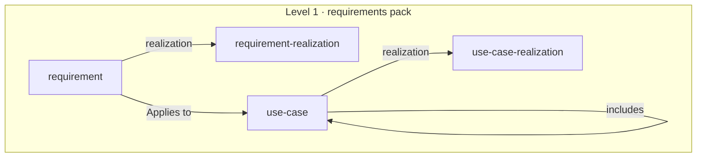

# Requirement and use-case realization

The requirements pack says what a product is held to and how anyone would tell it is met, and nothing says how far the product meets it today. A company that builds against its requirements keeps that answer beside them anyway, in a spreadsheet, a tracker or a generated table, where the model cannot read it and nothing holds it to the fit criterion it claims to meet. This spec adds two types to the requirements pack, `requirement-realization` and `use-case-realization`, each an ordered set of levels the instance defines, and lets a requirement and a use case name the level it has reached, say what is and is not realized, and list the evidence that shows it.

Status: decided by the owner on October 27, 2026: what is added is a realization, how far a build realizes the requirement or use case against its fit criterion, and not a status, which is a different thing; two types, `requirement-realization` and `use-case-realization`, both in the requirements pack now, though only the first has a company behind it; each an instance-owned set of levels, one file each at the top level, in the shape of core's decision status; a level's `rank` for the order and its `evidence` for what a page at that level must show, `none`, `satisfies` or `verifies`; on the requirement and the use case an optional `realization` field, a `## Realization` section that says what is realized and what is missing, and an `## Evidence` table whose rows each say whether they satisfy or verify; one instance check that holds a page to what its level asks; the pack's rule against a status on the page kept for everything but the realization; and a minor release.

## Where this comes from

One company shows the type, a company that builds software: a multi-person company specifying a platform keeps, beside each requirement of its model, how far a proof of concept realizes it, on an ordered scale whose top level needs a test and whose other levels need code or nothing, with a note on what is missing and the files that show it at one commit. It keeps all of it outside the model, in its specification's own data, and checks it there. A second instance, CompanyGraph's own, has requirements and use cases and keeps no realization; its requirements are about tooling that is built and tested, so it is the likely second user. No company shows a realization of a use case.

The pack's spec of October 11 left status out, "each moves, and a value that moves goes stale in the model without a sound", and its research found the failure it guarded against: specifications in the spec-kit shape each carry a status that was never maintained, though everything they specify was built. That finding still holds for a status written as a word. What answers it here is the evidence: a level names what it needs shown, every page at it lists the rows that show it at a commit, and a check holds the two together, so a stale realization is one whose evidence a reader can open and re-run rather than one nobody can test.

Public practice names the parts and does not combine them. ArchiMate's [realization relationship](https://pubs.opengroup.org/architecture/archimate30-doc/chap05.html) links a tangible how to an abstract what, and a core element realizes a requirement, which gives the word; the landscape and software packs already use `realizes` in that sense. SysML's [requirement relationships](https://en.wikipedia.org/wiki/Requirement_diagram) split a design element that satisfies a requirement from a test case that verifies it, and traceability tooling counts a requirement as traced only with both an [implementation and a verification link](https://www.mathworks.com/help/slrequirements/track-trace-and-visualize-links.html). Requirement attribute sets keep implementation and verification as two attributes ([Argon Digital](https://argondigital.com/blog/product-management/requirement-attributes-part-2)), and OpenUP's [requirement attributes](https://www.ida.liu.se/~TDDC88/openup/core.tech.common.extend_supp/guidances/concepts/requirement_attributes_4AC73153.html) list a status that is a "degree of completeness (completed, partial, not started)". NASA's [technology readiness levels](https://www.nasa.gov/wp-content/uploads/2017/12/458490main_trl_definitions.pdf) are one ordered scale whose levels are defined by the evidence each needs, the analog for a level that names its evidence.

## Levels and edges

The pack stays level 1. The two new types are named only by the pack's own types, and they name nothing; no core schema names either (R20).



The pack's edges down to core, which this spec does not change, are left out of the drawing.

## The two types

```text
model/
  requirement-realizations/<level>.md
  use-case-realizations/<level>.md
```

Both stand at the top, beside `requirements/` and `use-cases/`, as `decision-statuses/` stands beside `decisions/`: a level owns nothing, and every page realized to it names it. The set is the instance's own. Which levels a company tells apart, whether it separates built from shown, whether it has a level for part of a requirement, is a fact about that company, and a level arriving later is one file, not a release of the meta-model. Each schema carries core's `id`, `source` and `source-id`, a `## References` table, and a Purpose and Writing rules pair.

### requirement-realization

| Field | Required | Type | Description |
| --- | --- | --- | --- |
| `rank` | Yes | number | The level's place on the scale, rising with how far a requirement at it is realized. Spaced in tens so a level can be added without renumbering the others. |
| `evidence` | Yes | enum | `none`, `satisfies` or `verifies`. What a requirement at this level must show in its `## Evidence`: nothing; a row that satisfies it or verifies it; or a row that verifies it (SysML's satisfy and verify). |

Sections: `# [Label]`, the canonical name every requirement references; `> [Summary]`, one paragraph of what the level means; `## What it means`, required, when a requirement is at this level, what moves it here and on, and what a reader may rely on while it is; `## References`.

### use-case-realization

The same fields and sections, read against a use case: its main success scenario, its extensions and its guarantees, where a requirement's level is read against its fit criterion. It is a type of its own and not the requirement's levels reused, because a company that realizes a use case step by step may tell apart a main scenario that runs from one whose extensions run too, a distinction no requirement has.

## On the requirement and the use case

| Field | Required | Type | Description |
| --- | --- | --- | --- |
| `realization` | No | ref → requirement-realization | How far the requirement is realized, the H1 of a file in `requirement-realizations/` |

The use case takes the same field as `ref → use-case-realization`. Two sections join each schema, after `## Applies to` on the requirement and after `## Success guarantees` on the use case:

- `## Realization`, optional: what is realized and what is missing, measured against the fit criterion, or for a use case against its scenario and guarantees. A page that names a `realization` has it; the check below holds that, since the grammar cannot make a section required on a field's presence.
- `## Evidence`, optional, a table: `What` (string, what the row is, a file, a test, a recorded run), `Shows` (enum, `satisfies` or `verifies`: it builds the requirement, or it observes what the fit criterion observes) and `URL` (string, where it is, at the commit it was seen at).

A URL is a permalink at a commit, so each row says where it was seen and the page needs no commit of its own; a row that pointed at a branch would show something else tomorrow and still pass.

The two sections belong to the realization and say nothing without it, so a page that has either names a `realization`; a company that wants the trace defines its levels. A page at a level whose `evidence` is `none` may still list rows, since the file that shows what is missing is evidence too. A test that verifies a requirement is an `## Evidence` row once the page names a realization, and `## References` keeps the documents it was drawn from or that stand behind it, the specification and the standard: one fact in one place. The requirement's `## References` description drops "the test that proves it", and a writing rule says where the test goes; a page that still lists a test under References fails nothing.

## The check it owes

One norm spans two pages: a requirement or use case whose `realization` names a level whose `evidence` is `satisfies` has at least one `## Evidence` row; one whose level's `evidence` is `verifies` has at least one row whose `Shows` is `verifies`. The same check fails a page that names a `realization` and has no `## Realization`, and a page that has `## Realization` or `## Evidence` and names no `realization`. It is declared on the two page types in `PACKS` by the field, the level's field and the section and column it reads, and it runs where an instance takes the pack, with a fixture that breaks each of its four failures.

What one page says is held by the grammar: `realization` resolves by R4, `evidence` and `Shows` are enums by R8. That a row's URL is pinned to a commit, and that a level's `## What it means` says what moves a page into and out of it, are writing rules.

## The decisions, and why

**A realization, not a status.** A requirement has more than one thing a reader calls its status. One is how far the specification answers it, settled, open or in conflict, which follows from the decisions and questions that name it and is derived, not written. Another is how far a build realizes it, which is a fact about the build and needs evidence. A field named `status` would be read as either, and the second is the one a page can hold. "Completeness" was the other candidate, and it is rejected because a complete requirement, in requirements practice, is one whose statement leaves nothing out.

**Both types now, in the pack.** One company is usually a wait for the second. The types go in now because they extend a pack that exists, every field is optional, public practice keeps the attribute wherever requirements are tracked, and the second instance is a likely user. `use-case-realization` has no company behind it at all; it comes with its twin so that a use case and the requirements that apply to it can be read on the same terms, and an instance that never defines a level never sees it.

**The instance's own levels, in the shape of decision status.** Core's decision status already is a set of states a company defines, one file each, with what each licenses a reader to do. The levels are the same kind of thing and take the same shape, plus the two fields a level needs that a status does not: an order, and the evidence it asks for.

**One ladder, with the evidence on the level.** Practice keeps implementation and verification as two attributes. One ordered field with the kind of evidence on each level carries both, because the top of the ladder is defined by verification and the rest by implementation, and it keeps one place to read how far a requirement is. The level saying what it needs, rather than the page, is what lets the check hold a page to it.

**Satisfies and verifies on the row.** A check cannot tell a test from code by its path. The row says which it is, in SysML's two words, so a level that asks for verification is held to a row that claims it.

**The rule against status stays, narrowed.** The requirement schema's writing rule says the page holds no priority, status, release or date. It keeps priority, status, release and date out, and says the realization is the one value on the page that moves, held to its evidence.

## Where this departs from its sources

- SysML draws satisfy and verify as relationships from a design element or a test case to the requirement; here they are a column on a row of the requirement's own page, because the code and the tests are outside the model and have no page to draw from.
- Practice keeps implementation status and verification status as two attributes; here they are one ordered level whose evidence decides which it is.
- OpenUP's status is a degree of completeness with fixed values; here the values are the instance's own.

## What was left out

The derived state of the specification, settled, open or in conflict, which an instance can compute from the decisions and questions that name a requirement and which no page should repeat. A grouping of requirements by subject, which one company keeps beside the pack's `kind` and which is a candidate kind type of its own. A realization per product, for a requirement that applies to several and is realized in one; a page carries one realization, and a company that needs more writes the requirement once per product. A history of levels, which git holds.

## Out of scope

Which instances define levels and how. The company the type comes from moves its scale into its own model and reads it back into its specification, in its own repositories and pull requests.

## What it costs

Two schemas in `packs/requirements/` and a changed requirement and use case schema, with the README's table, sources and departures brought up to them; two entries in `PACKS` and the declared check with its fixtures. The example defines requirement levels and use-case levels, and its requirement and a use case each name one with evidence rows, so the field, the sections and the check are proven on content for both types; the use case's levels tell a main scenario that runs from one whose extensions run too. No change to core, and nothing an instance must do, so it is a minor release.
